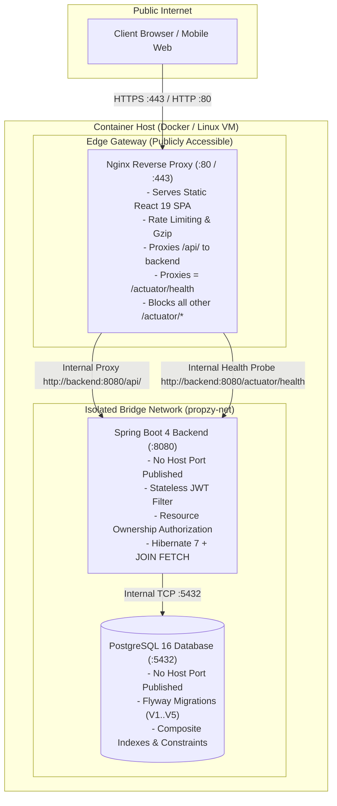

# Propzy — Modern Rental Property Management Platform

[](https://github.com/sourabh045-arc/Propzy/actions/workflows/ci.yml)
[](https://openjdk.org/projects/jdk/21/)
[](https://spring.io/projects/spring-boot)
[](https://www.postgresql.org/)
[](https://flywaydb.org/)
[](https://react.dev/)
[](https://www.typescriptlang.org/)
[](https://vitejs.dev/)
[](backend/src/test)
[](LICENSE)

A full-stack, enterprise-grade rental property management platform built with **Java 21**, **Spring Boot 4**, **PostgreSQL 16**, and **React 19 / TypeScript**. Engineered with a security-first architecture featuring stateless JWT authentication, defense-in-depth authorization, concurrent registration race condition handling, optimistic locking for inquiry lifecycles, full functional property pagination, Flyway database migrations, PostgreSQL Testcontainers, network isolation, and automated verification suites across backend and frontend.

---

## 🏗️ System Architecture

### Production Topology (Isolated Docker Network)

In production, Propzy enforces a **single-entrypoint architecture**. The Spring Boot application server and PostgreSQL database are shielded from the public internet inside a private Docker bridge network (`propzy-net`). Only the hardened Nginx reverse proxy accepts external traffic.



---

## 🔒 Security Architecture & Hardening Highlights

| Control Area | Production Implementation |
|---|---|
| **Secret Management** | Strictly requires environment-provided `JWT_SECRET` (256-bit Base64) and `DB_PASSWORD`. Zero hardcoded fallback secrets in production configuration; application fails startup immediately if missing or weak. |
| **Network Perimeter** | Backend port 8080 and PostgreSQL port 5432 are **not** published to the host machine. Nginx acts as the sole ingress point. |
| **Operational Hardening** | Actuator endpoints are locked down. Nginx proxies strictly `GET = /actuator/health` and explicitly returns `404` for all other `/actuator/*` paths (preventing leakage of env, heap dumps, or beans). |
| **Verified Builds** | Production Dockerfiles compile and run the full automated test suite inside the multi-stage builder. Broken code cannot produce a deployable container image. |
| **Multi-Tenant Isolation** | Resource-level ownership checks (`requireOwnership(property, owner)`) in the service layer prevent unauthorized editing or deletion of other owners' listings. |
| **Password Hashing** | BCrypt hashing with standard salt rounds for all user credentials. Passwords are never returned in DTOs or logs. |
| **Container Security** | The backend container runs as an unprivileged, non-root user (`propzy:propzy`) on Alpine Linux. |
| **Safe Expired Token Handling** | Expired or invalid JWT tokens never cause public endpoints (property browsing) to fail, while protected endpoints strictly reject expired tokens with HTTP 401. |
| **Standardized Error Handling** | Global exception handling ensures all error responses follow a uniform RFC-compliant JSON structure without leaking Java stack traces or internal SQL errors. |

---

## 🛠️ Technology Stack

### Backend
- **Java 21 (LTS)** — Modern Java features including Records, Pattern Matching, and Sealed Classes.
- **Spring Boot 4.1.1** — Dependency injection, autoconfiguration, and modern REST architecture.
- **Spring Security** — Stateless filter chain with HMAC-SHA256 JWT validation (`io.jsonwebtoken 0.12.6`).
- **Spring Data JPA & Hibernate 7** — Declarative persistence with JPQL `JOIN FETCH` queries, composite indexing, and optimistic locking (`@Version`).
- **Jakarta Bean Validation** — Declarative constraints on DTOs (`@NotBlank`, `@DecimalMin`, `@Email`).
- **Flyway 12** — Versioned migrations (`V1` users, `V2` properties, `V3` search indexes, `V4` inquiries, `V5` optimistic locking version) applied automatically on startup.
- **PostgreSQL 16 & Testcontainers** — Real PostgreSQL containerized integration testing verifying migrations, constraints, and indexes.

### Frontend
- **React 19** — Component-based architecture with hooks and functional components.
- **TypeScript 6** — Strict end-to-end type contracts matching backend DTO schemas.
- **Vite 8** — Production bundler with lightning-fast Hot Module Replacement (HMR).
- **Axios** — Centralized HTTP client with relative URL same-origin routing and automatic 401 token cleanup.
- **Lucide React** — Modern, lightweight SVG iconography.
- **Vitest & Testing Library** — Automated component and interaction testing.
- **Oxlint** — Ultra-fast Rust-based linter (0 errors, 0 warnings).

### Infrastructure & DevOps
- **Docker & Docker Compose** — Multi-stage Alpine containerization with network isolation.
- **Nginx Alpine** — Single entry point reverse proxy and static asset server with Gzip compression.
- **GitHub Actions** — Continuous Integration verifying backend tests, PostgreSQL Testcontainers, frontend linting, TypeScript compilation, Vitest tests, and container builds on every push.

---

## 📁 Repository Structure

```
Propzy/
├── .github/
│   └── workflows/
│       └── ci.yml                 # GitHub Actions CI workflow (Java 21, Node 20, Testcontainers, Docker)
├── backend/
│   ├── src/
│   │   ├── main/
│   │   │   ├── java/com/rentflow/backend/
│   │   │   │   ├── config/        # SecurityConfig, GlobalExceptionHandler
│   │   │   │   ├── controller/    # HealthController
│   │   │   │   ├── inquiry/       # Inquiry entity, controller, service, repository, DTOs
│   │   │   │   ├── property/      # Property entity, controller, service, repository, DTOs
│   │   │   │   ├── security/      # JwtAuthenticationFilter, JwtService
│   │   │   │   └── user/          # User entity, AuthController, UserService, AuthService, DTOs
│   │   │   └── resources/
│   │   │       ├── db/migration/  # Flyway SQL migrations (V1..V5)
│   │   │       ├── application.properties
│   │   │       └── application-dev.properties
│   │   └── test/                  # 61+ Integration & Unit tests, PostgreSQL Testcontainers
│   ├── Dockerfile                 # Multi-stage secure build (Temurin 21 non-root)
│   └── pom.xml                    # Maven dependencies and plugins
├── frontend/
│   ├── src/
│   │   ├── assets/                # Propzy branding, logo, icons
│   │   ├── test/                  # Vitest setup
│   │   ├── App.tsx                # Main application UI, routing, auth, pagination, inquiry flows
│   │   ├── App.css                # Polished styling and responsive layout
│   │   └── App.test.tsx           # Automated frontend tests
│   ├── public/                    # Favicon, Propzy logo asset
│   ├── nginx.conf                 # Production Nginx reverse proxy configuration
│   ├── Dockerfile                 # Multi-stage production build (Node 20 + Nginx Alpine)
│   ├── package.json
│   └── vite.config.ts
├── database/
│   └── docker-compose.yml         # Standalone PostgreSQL helper for local development
├── docker-compose.yml             # Production multi-container composition
├── docker-compose.override.yml.example
├── .env.example                   # Environment configuration template
└── README.md
```

---

## 🚀 Key Functional Features

### 1. Authentication & Role-Based Access Control
- **Dual User Roles**: Registered users specify `TENANT` or `OWNER` during registration.
- **Secure Registration**: Concurrent registration protection prevents race condition 500 errors and returns clean `409 Conflict` on duplicate emails.
- **Session Restoration & Interception**: Stored JWTs restore sessions on load; expired tokens are cleaned up automatically without interrupting public browsing.

### 2. Property Management & Search
- **Public Property Browsing**: Accessible to anonymous visitors and authenticated users alike.
- **Multi-Criteria Search**: Case-insensitive city search and numeric rent limits (`minRent`, `maxRent`).
- **Functional Pagination**: Real pagination controls (page size 12, previous/next navigation, total count, active page indicators) that preserve active filters across pages.
- **Owner Operations**: Property owners can list, modify, and delete their own properties with strict ownership validation (`requireOwnership`).

### 3. Tenant-Owner Inquiries Workflow
- **Inquiry Submission**: Tenants can submit detailed inquiries directly to property owners.
- **Owner Dashboard**: Owners receive and review incoming inquiries in real-time.
- **State Machine Rules**:
  - `PENDING` → `ACCEPTED`
  - `PENDING` → `REJECTED`
  - Finalized inquiries (`ACCEPTED` or `REJECTED`) cannot be transitioned again (`409 Conflict`).
  - Optimistic locking via JPA `@Version` guarantees concurrent status updates cannot overwrite each other.

---

## ⚙️ Local Development Setup

### Prerequisites
- Java 21 JDK (Eclipse Temurin recommended)
- Node.js 20+ and npm
- Docker (optional for local standalone, required for container deployment)
- Maven 3.9+ (or use included `./mvnw`)

### 1. Database Setup (Local)
Start a local PostgreSQL instance using the helper compose file:
```bash
docker compose -f database/docker-compose.yml up -d
```
Alternatively, use an existing PostgreSQL server running on port 5433 with database `propzy`.

### 2. Backend Startup
```bash
cd backend
mvn spring-boot:run -Dspring-boot.run.profiles=dev
```
The backend starts on `http://localhost:8080`.

### 3. Frontend Startup
```bash
cd frontend
npm install
npm run dev
```
The Vite development server starts on `http://localhost:5173`.

---

## 🐳 Production Deployment (Docker Compose)

### 1. Configure Environment
```bash
cp .env.example .env
```
Generate strong random values for `DB_PASSWORD` and `JWT_SECRET`:
```bash
# Generate 256-bit Base64 JWT Secret
openssl rand -base64 32
```
Update `.env` with your secure secrets.

### 2. Launch Multi-Container Stack
```bash
docker compose up -d --build
```

### 3. Verification & Health Check
```bash
# Check container status
docker compose ps

# View application logs
docker compose logs -f

# Verify public health endpoint
curl -I http://localhost:5173/actuator/health
```

The application is accessible at:
- **Web UI**: `http://localhost:5173`
- **Health Check**: `http://localhost:5173/actuator/health`

---

## 🧪 Testing & Verification

### Backend Verification
Run the complete automated test suite (including unit, integration, and security tests):
```bash
cd backend
./mvnw clean verify
```

### Frontend Verification
Run linting, automated unit tests, and production build:
```bash
cd frontend
npm run lint    # Oxlint static analysis
npm test        # Vitest automated test suite
npm run build   # TypeScript compilation & Vite bundle
```

---

## 📄 License
This project is licensed under the MIT License — see the [LICENSE](LICENSE) file for details.
